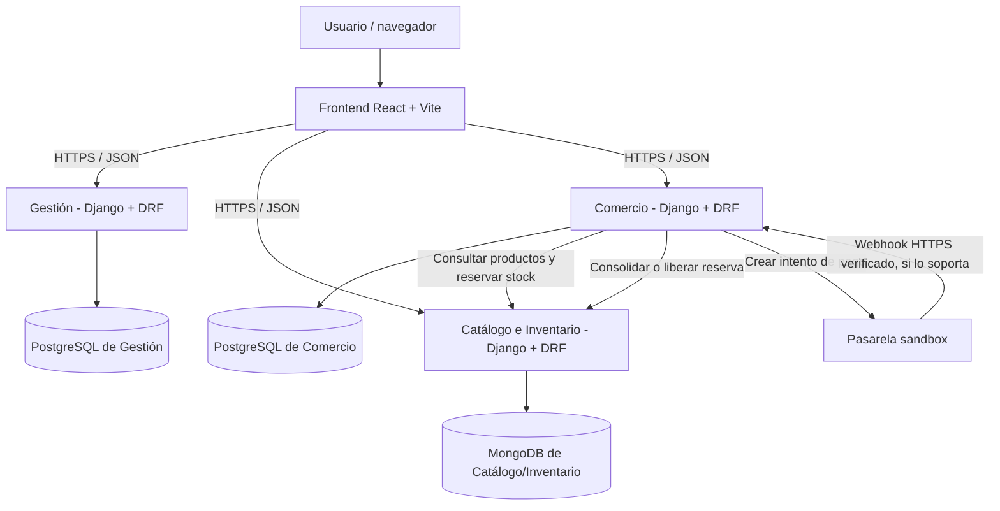
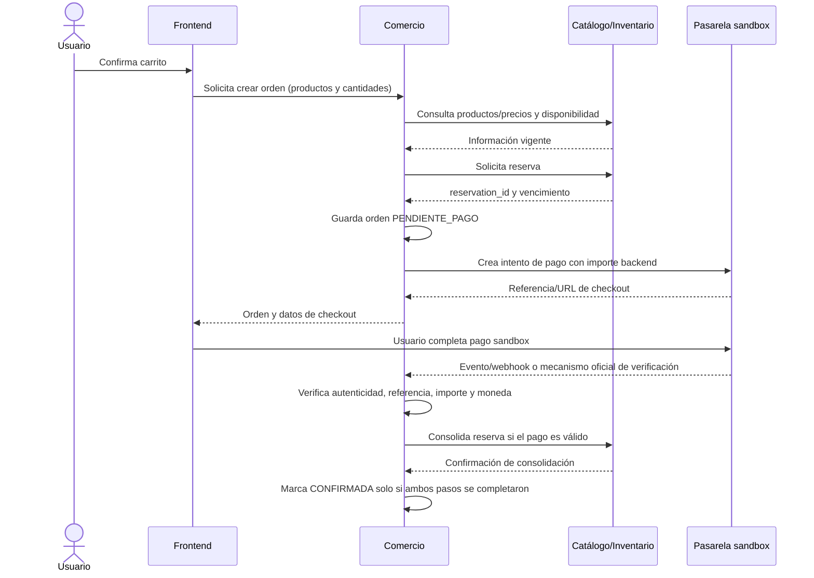

# Arquitectura general propuesta — Solemne 02

**Estado:** borrador técnico para revisión del equipo. Las decisiones, rutas y flujos aquí descritos deben validarse con el enunciado y con los responsables de Gestión y Catálogo/Inventario antes de considerarlos definitivos.

## 1. Diagrama

## 2. Propiedad de datos propuesta

| Servicio | Persistencia propuesta | Datos bajo su responsabilidad |
|---|---|---|
| Gestión | PostgreSQL | Usuarios/perfiles, roles y datos administrativos asignados por el enunciado |
| Catálogo e Inventario | MongoDB | Productos, disponibilidad, stock, reservas y movimientos de inventario |
| Comercio | PostgreSQL | Carritos, órdenes, líneas de orden, intentos de pago y conciliación |

Cada servicio debe ser dueño de sus datos. Los demás servicios deben acceder mediante APIs documentadas, no conectándose directamente a su base de datos.

## 3. Responsabilidades

### Gestión
- Administrar las funciones de usuarios, roles y datos que le asigne el enunciado.
- Publicar endpoints documentados.
- No compartir acceso directo a su base de datos con los otros servicios.

### Catálogo e Inventario
- Ser la fuente de verdad de productos y stock.
- Validar disponibilidad en el momento de reservar.
- Permitir reservar, consultar, liberar y consolidar inventario con operaciones idempotentes.
- Gestionar vencimientos de reservas según una política acordada.

### Comercio
- Gestionar carritos, órdenes, pagos y conciliación.
- Calcular los importes en backend a partir de precios confiables; no aceptar el total del navegador como autoridad.
- Coordinar la reserva y consolidación/liberación de stock.
- Validar eventos de pago y evitar procesarlos dos veces.

## 4. Flujo de compra propuesto

**Invariante crítica:** una orden solo pasa a `CONFIRMADA` cuando el pago se verifica en backend y el inventario se consolida. Si hay incertidumbre o falla parcial, la orden queda sin confirmar y debe entrar en reintento/conciliación. La redirección del navegador por sí sola no prueba el pago.

## 5. Reglas transversales

1. HTTPS para frontend, APIs publicadas y webhook.
2. Secretos en variables de entorno; nunca subir `.env` ni claves a Git.
3. CORS limitado a los orígenes necesarios; no sustituye autenticación.
4. Operaciones de reserva, liberación, consolidación y webhook idempotentes.
5. Validar referencia, importe, moneda y estado de pago en backend.
6. Definir timeouts, reintentos limitados y trazabilidad por `order_id`, reserva e intento de pago.
7. No acceder directamente a bases de datos de otros servicios.
8. Contratos con rutas, métodos, payloads, autenticación y errores acordados antes de integrar.

## 6. Pendientes que debe confirmar el equipo

- [ ] ¿El frontend llama a los tres servicios directamente o habrá un gateway?
- [ ] ¿Cómo se autentica al usuario y cómo se propaga la identidad entre servicios?
- [ ] ¿Cuáles son los endpoints/modelos reales de Gestión y Catálogo/Inventario?
- [ ] ¿Qué pasarela sandbox se eligió y cómo verifica firmas/eventos?
- [ ] ¿Qué formato de importe y moneda espera la pasarela para CLP?
- [ ] ¿Cuál es la política de vencimiento y liberación de reservas?
- [ ] ¿Qué plataforma publicará el primer endpoint?

## 7. Criterios de aceptación

- [ ] Se muestran frontend, los tres servicios, persistencias y pasarela sandbox.
- [ ] Cada base de datos tiene un propietario.
- [ ] Se representan llamadas de Comercio a Catálogo/Inventario.
- [ ] Se distingue retorno del navegador de verificación del pago.
- [ ] La orden no se confirma antes de pago verificado e inventario consolidado.
- [ ] Las decisiones no confirmadas están marcadas como pendientes.
