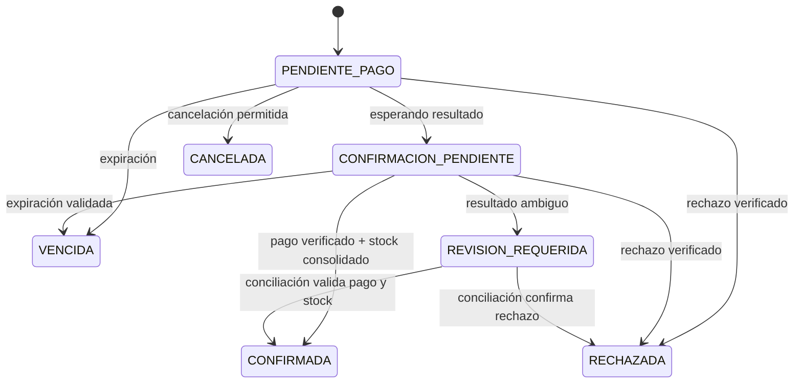

# Contrato de API entre servicios — borrador

**Estado:** propuesta inicial para acordar con el equipo. Las rutas y los payloads son ejemplos, no endpoints confirmados ni necesariamente implementados. Validarlos con el enunciado y el código real.

## 1. Convenciones

- Transporte: HTTPS en despliegues.
- Formato: JSON (`application/json`).
- Prefijo sugerido: `/api/v1/`.
- Fechas: ISO 8601.
- IDs: UUID o identificadores opacos estables.
- Autenticación entre servicios: acordar mecanismo; no dejar endpoints internos sensibles abiertos.
- Errores consistentes; no exponer secretos, trazas internas ni datos privados.
- Definir timeout y reintentos limitados para llamadas entre servicios.

## 2. Formato de error propuesto

```json
{
  "error": {
    "code": "INSUFFICIENT_STOCK",
    "message": "No hay unidades suficientes para reservar.",
    "request_id": "uuid"
  }
}
```

## 3. Comercio → Catálogo/Inventario (rutas propuestas)

### Consultar producto
`GET /api/v1/products/{product_id}/`

Respuesta de ejemplo:
```json
{
  "id": "product-uuid",
  "name": "Producto de ejemplo",
  "unit_price": "4990",
  "currency": "CLP",
  "active": true
}
```

### Crear reserva
`POST /api/v1/inventory/reservations/`

Usar una cabecera idempotente como `Idempotency-Key`.

Solicitud:
```json
{
  "order_id": "order-uuid",
  "items": [
    {"product_id": "product-uuid", "quantity": 2}
  ]
}
```

Respuesta propuesta:
```json
{
  "reservation_id": "reservation-uuid",
  "order_id": "order-uuid",
  "status": "RESERVED",
  "expires_at": "2026-10-18T15:00:00Z"
}
```

Validaciones: cantidad positiva, producto activo y stock suficiente. La misma solicitud repetida no debe reservar stock dos veces. Sin stock, devolver un error de conflicto como `409 INSUFFICIENT_STOCK`.

### Consultar reserva
`GET /api/v1/inventory/reservations/{reservation_id}/`

Respuesta: identificador, orden asociada, estado y vencimiento. Estados sugeridos: `RESERVED`, `CONSOLIDATED`, `RELEASED`, `EXPIRED`; confirmar con el equipo.

### Consolidar reserva
`POST /api/v1/inventory/reservations/{reservation_id}/consolidate/`

Solicitud:
```json
{
  "order_id": "order-uuid",
  "payment_attempt_id": "payment-attempt-uuid"
}
```

Reglas: operación idempotente; no consolidar reservas vencidas/liberadas. Si falla, Comercio no marca la orden como confirmada y activa conciliación.

### Liberar reserva
`POST /api/v1/inventory/reservations/{reservation_id}/release/`

Solicitud:
```json
{
  "order_id": "order-uuid",
  "reason": "PAYMENT_REJECTED"
}
```

Reglas: liberar ante rechazo, cancelación o vencimiento según política acordada; tolerar repetición.

## 4. API pública de Comercio (propuesta)

| Método | Ruta sugerida | Propósito |
|---|---|---|
| `POST` | `/api/v1/orders/` | Crear orden y reservar stock |
| `GET` | `/api/v1/orders/{order_id}/` | Consultar orden y estado |
| `POST` | `/api/v1/orders/{order_id}/cancel/` | Cancelar si la transición está permitida |
| `POST` | `/api/v1/orders/{order_id}/payment-attempts/` | Crear intento de pago sandbox |
| `GET` | `/api/v1/orders/{order_id}/payment-status/` | Consultar estado de pago |
| `POST` | `/api/v1/payments/webhook/` | Recibir evento de pago según el proveedor |

### Crear orden
Solicitud:
```json
{
  "items": [
    {"product_id": "product-uuid", "quantity": 2}
  ]
}
```

El backend obtiene los precios confiables y calcula total/moneda. No confiar en precio, subtotal, total o moneda enviados por el frontend.

Respuesta:
```json
{
  "order_id": "order-uuid",
  "status": "PENDIENTE_PAGO",
  "currency": "CLP",
  "total": "9980"
}
```

### Crear intento de pago
Solicitud:
```json
{
  "order_id": "order-uuid",
  "return_url": "https://frontend.example/checkout/return"
}
```

Respuesta:
```json
{
  "payment_attempt_id": "payment-attempt-uuid",
  "order_id": "order-uuid",
  "status": "PENDIENTE",
  "checkout_url": "https://sandbox.example/checkout/...",
  "currency": "CLP",
  "amount": "9980"
}
```

La URL de retorno debe validarse con una lista permitida. No exponer credenciales privadas al navegador. Confirmar si el proveedor de pago espera CLP como entero.

## 5. Webhook de pago

El payload y la firma exactos dependen de la pasarela seleccionada; no inventar su formato.

1. Verificar autenticidad según documentación oficial del proveedor.
2. Procesar cada evento una sola vez mediante un ID único de evento.
3. Validar orden, intento de pago, monto, moneda y estado.
4. Si el resultado es ambiguo, consultar el proveedor por un canal autenticado o marcar `REVISION_REQUERIDA`.
5. Solo confirmar la orden cuando el pago esté verificado y la reserva de inventario consolidada.
6. Registrar lo necesario para conciliar, sin almacenar secretos.

## 6. Estados de orden

Estados mínimos identificados para el proyecto:
- `PENDIENTE_PAGO`
- `CONFIRMACION_PENDIENTE`
- `CONFIRMADA`
- `RECHAZADA`
- `CANCELADA`
- `VENCIDA`
- `REVISION_REQUERIDA`

Diagrama sugerido para validar:


El frontend no debe poder imponer directamente un estado final.

## 7. Códigos HTTP sugeridos

| HTTP | Código | Uso |
|---|---|---|
| `400` | `VALIDATION_ERROR` | Campos inválidos |
| `401` | `UNAUTHENTICATED` | Credenciales inválidas |
| `403` | `FORBIDDEN` | Sin permisos |
| `404` | `NOT_FOUND` | Recurso inexistente |
| `409` | `INSUFFICIENT_STOCK` / `INVALID_STATE_TRANSITION` | Conflicto de negocio |
| `422` | `BUSINESS_RULE_VIOLATION` | Regla de negocio incumplida |
| `502` | `UPSTREAM_SERVICE_ERROR` | Dependencia no disponible |
| `503` | `SERVICE_UNAVAILABLE` | Indisponibilidad temporal |

## 8. Idempotencia y recuperación

- Hacer idempotentes reservas, liberaciones, consolidaciones y eventos de pago.
- Si se pierde la respuesta de una operación, no asumir que falló: consultar o repetir con la misma clave idempotente.
- Si se verificó el pago pero falla la consolidación, no confirmar la orden; dejar trazabilidad y reintentar/conciliar.
- Si se reservó stock pero no se inicia el pago, liberar o esperar vencimiento según política.
- Probar webhook duplicado, falta de stock, timeout, pago rechazado y fallo de consolidación.

## 9. Pendientes

- [ ] Acordar rutas y modelos con Catálogo/Inventario.
- [ ] Acordar autenticación con Gestión.
- [ ] Elegir pasarela sandbox y confirmar formato de monto, moneda, firma y reintentos.
- [ ] Definir vencimiento de reserva y orden.
- [ ] Alinear contrato con código y generar OpenAPI.

Para documentar APIs DRF, la documentación oficial recomienda `drf-spectacular` para generar esquemas OpenAPI:
- https://www.django-rest-framework.org/topics/documenting-your-api/
- https://drf-spectacular.readthedocs.io/en/stable/
