# Verificacion de accesibilidad y responsividad

## Responsivo
A continuación se podrán encontrar 3 imagenes por cada uno de los tres distintos tipos de tamaños solicitados, 360px, 760px y 1440px, cada una de las capturas muestran:
- La vista de la página principal
- El despligue del menu desplegable en caso de las pantallas más pequeñas
- Las vistas de las páginas contacto y catálogo
### 360px
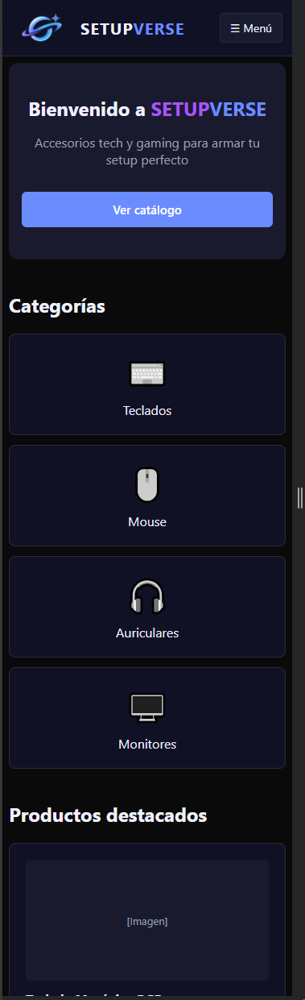
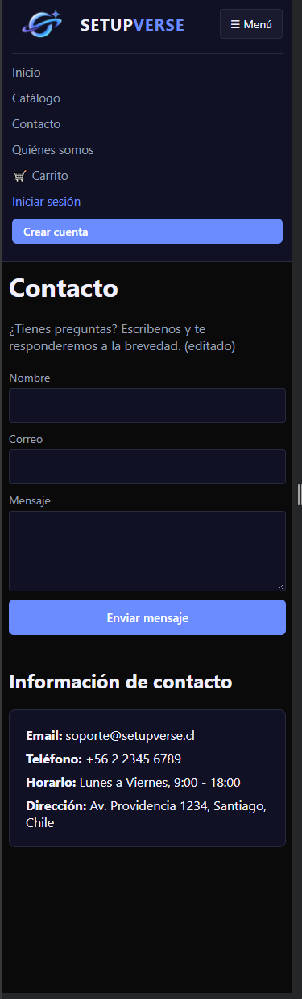
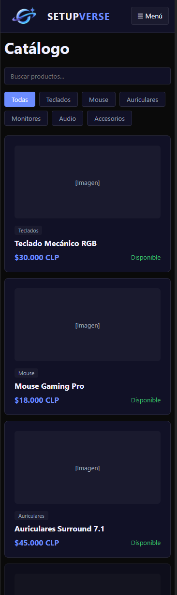

### 760px
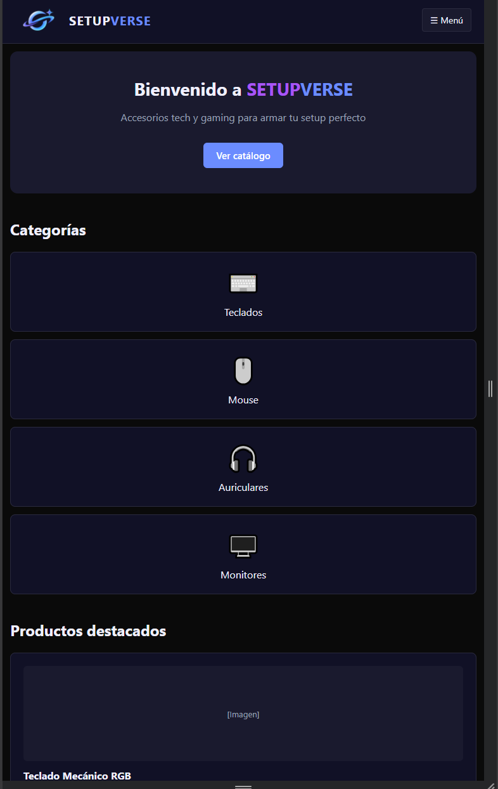
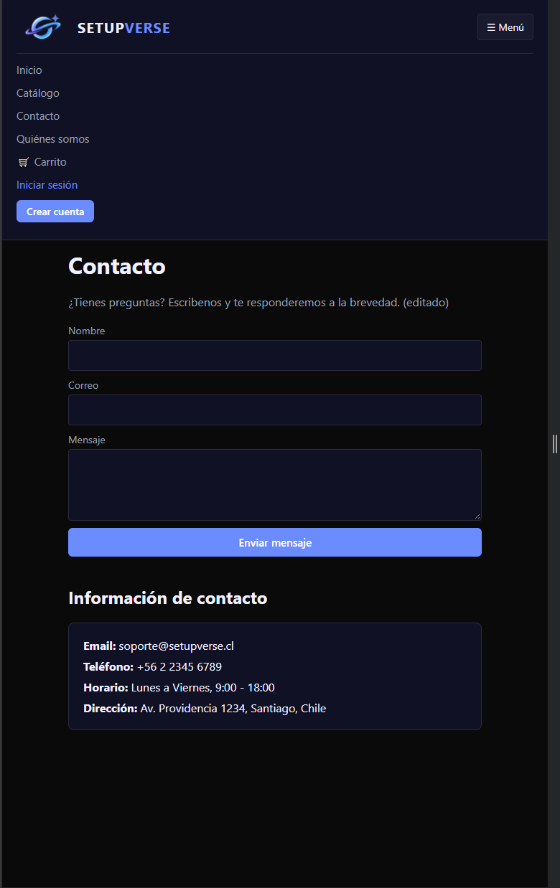

### 1440px
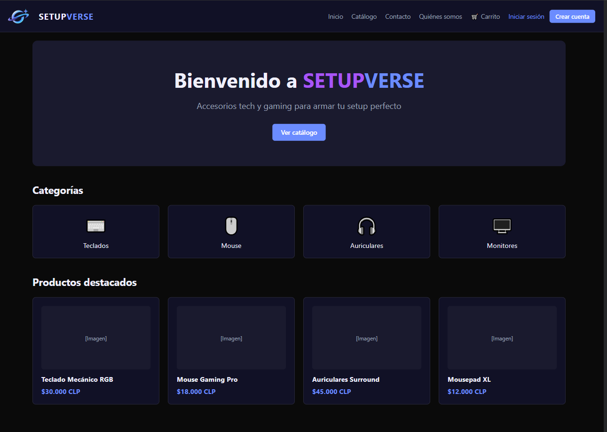
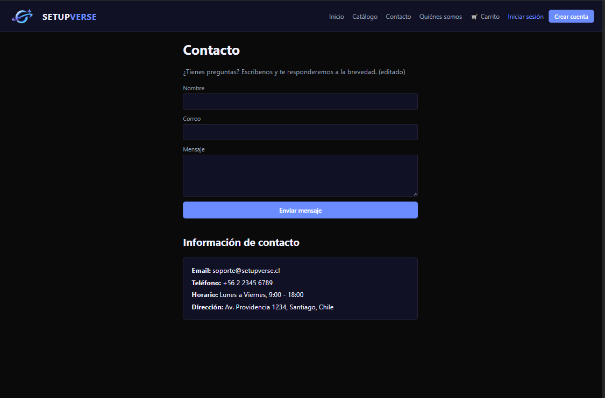
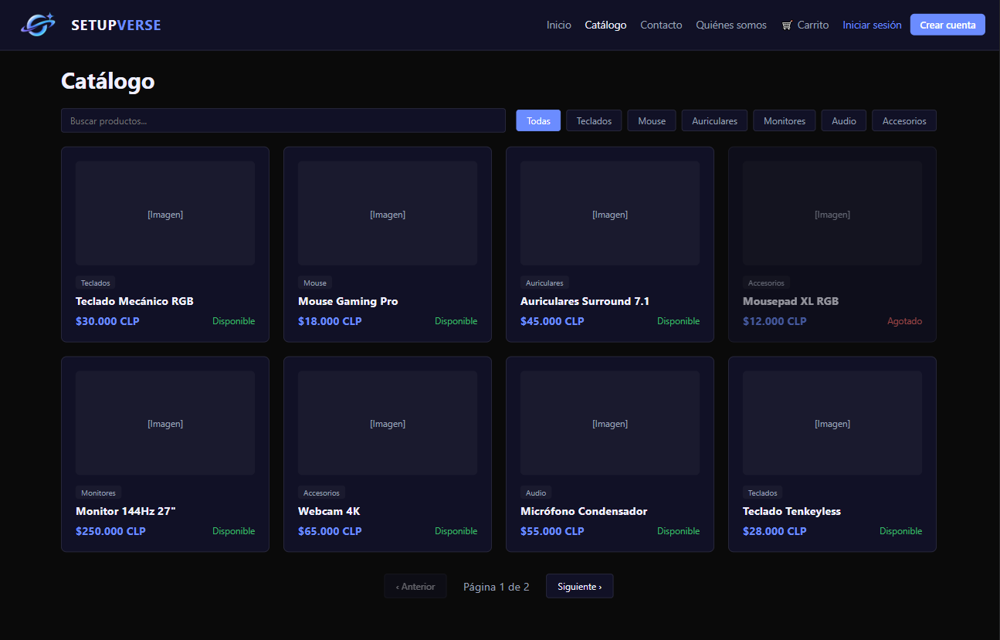

## Accesibilidad: navegación con teclado
En accesibilidad tenemos la navegación con la tecla `tab`, se muestran capturas cercanas de el acceso a la pagina de inicio, parte del menu de contenidos y acceso a contenido directo de los productos. 
NOTA: se puede navegar en reversa con `shift`+`tab`.
Al inicio de la navegacion couando se presiona `tab` saldra en la esquina superior derecha un recuadro saltar al contenido principal, al dar en `Enter` te guiara directo al boton **Ver catálogo** dentro del contenido "saltando" el paso por el menu en la barra de navegación
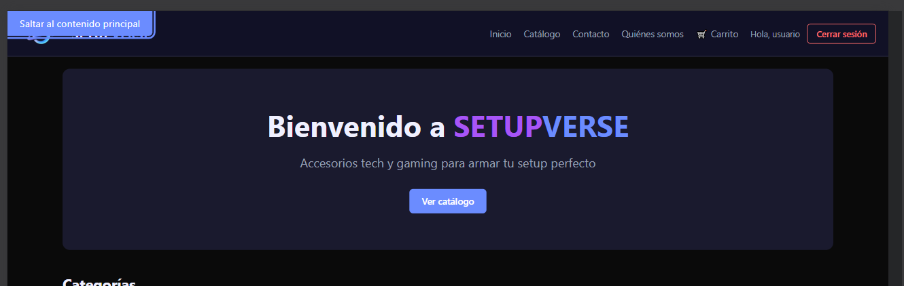

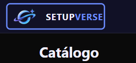
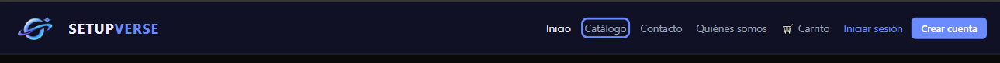
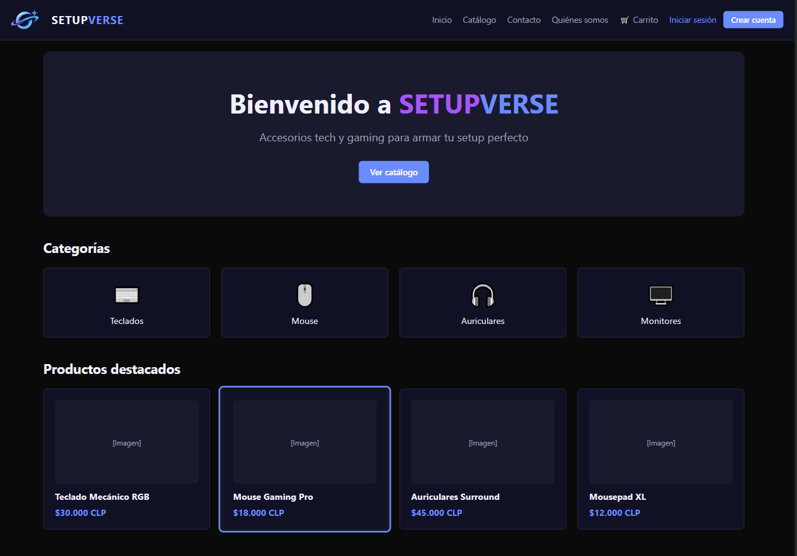

