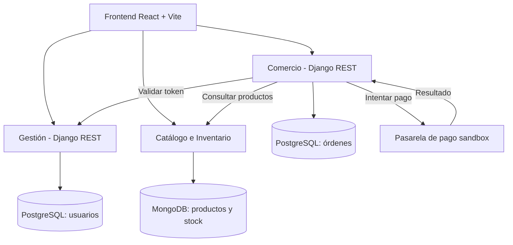

# Arquitectura general y contrato de API

## 1. Diagrama general



El diagrama representa la arquitectura objetivo. Las llamadas deben probarse antes de considerarse operativas.

## 2. Propiedad de datos

| Servicio | Base de datos | Datos propios |
|---|---|---|
| Gestión | PostgreSQL | Usuarios, credenciales, roles y estados de cuenta. |
| Catálogo e Inventario | MongoDB (objetivo) | Productos, precios y stock. |
| Comercio | PostgreSQL | Órdenes, detalles históricos, estados y referencias de pago. |

Cada servicio administra sus propios datos. Los demás servicios acceden mediante API REST, sin conectarse directamente a sus bases de datos.

## 3. Contrato entre Gestión y Comercio

**Método:** GET  
**Endpoint:** `/api/usuarios/verificar-token/`  
**Consumidor:** Comercio.

Cabecera:
```http
Authorization: Token <token>
```

Respuesta esperada: identidad del usuario, rol y estado de la cuenta. Los campos exactos deben coincidir con la respuesta real de Gestión.

Reglas:
- Token inválido: `401 Unauthorized`.
- Usuario sin permisos: `403 Forbidden`.
- Una cuenta bloqueada no debe realizar operaciones protegidas.

## 4. Contrato entre Catálogo y Comercio

**Método esperado:** GET  
**Endpoint esperado:** `/api/productos/{id}/`  
**Consumidor:** Comercio.

Respuesta ilustrativa:
```json
{
  "nombre": "Producto de ejemplo",
  "precio": "19990",
  "moneda": "CLP",
  "stock_disponible": 10
}
```

Los valores son ejemplos. Catálogo debe confirmar la ruta y el formato definitivo.

Reglas:
- Validar que el producto exista.
- Validar precio y cantidad.
- Comprobar stock disponible.
- No modificar directamente la base de datos de Catálogo desde Comercio.

## 5. API de Comercio

Rutas identificadas en el código:
- `POST /api/ordenes/`: crear una orden.
- `/api/ordenes/{id}/`: ruta de detalle; confirmar los métodos permitidos en la vista.

Responsabilidades:
1. Validar identidad cuando corresponda.
2. Consultar productos y disponibilidad.
3. Validar cantidades y precios.
4. Crear la orden con estado inicial `PENDIENTE_PAGO`.
5. Guardar una copia histórica de los datos relevantes.
6. Registrar el resultado del pago y actualizar el estado.

La reserva y liberación de stock deben acordarse con Catálogo. No se consideran implementadas hasta probarlas.

## 6. Errores y consistencia

| Situación | Respuesta esperada |
|---|---|
| Token inválido | `401` |
| Sin permisos | `403` |
| Producto inexistente | `404` |
| Solicitud inválida | `400` |
| Servicio dependiente no disponible | `502` o `503` |

Las respuestas deben utilizar JSON coherente. Los reintentos no deben duplicar órdenes ni pagos.

## 7. Estado de implementación

- Gestión: código recuperado, conexión a PostgreSQL y migración inicial comprobadas.
- Comercio: rutas de órdenes y llamada de validación de token presentes en el código.
- Catálogo e Inventario: código e integración pendientes de verificar.
- Pasarela de pago: intento sandbox pendiente de confirmar.
- Frontend y despliegue remoto: pendientes de comprobar.

La arquitectura descrita es el diseño objetivo; no implica que todas las integraciones estén terminadas.

## 8. Criterios de aceptación

- Diagrama con los tres servicios, la propiedad de datos y sus llamadas.
- Contratos con métodos, rutas, autenticación y respuestas.
- Errores y reglas de consistencia documentados.
- Diferenciación entre funcionalidades implementadas y pendientes.
- Rutas y respuestas contrastadas con el código antes de la entrega.

## 9. Configuración de integración

Comercio utiliza las variables de entorno `GESTION_VERIFY_TOKEN_URL` para verificar tokens y `CATALOGO_API_BASE_URL` para consultar productos. Configura ambas según las direcciones reales de los servicios. La integración con Catálogo sigue pendiente de comprobarse.
