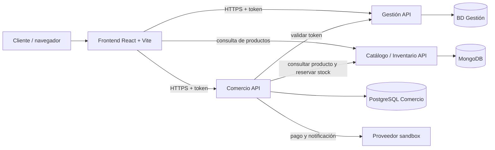

# Arquitectura general — Solemne 02

**Estado:** propuesta de arquitectura; validar rutas y despliegue con el equipo.

## Componentes y propiedad de datos
- **Frontend (React + Vite):** interfaz; no es fuente de verdad para precios, stock ni resultado del pago.
- **Gestión (Django REST Framework):** usuarios y autenticación; base de datos propia.
- **Catálogo/Inventario (DRF + MongoDB):** productos y stock; reservas, liberaciones y consolidaciones.
- **Comercio (Django REST Framework + PostgreSQL):** órdenes, ítems históricos y estado de compra.
- **Proveedor de pago sandbox:** procesa pruebas de pago y notifica a Comercio.

## Diagrama lógico

## Flujo de compra de referencia
1. El frontend solicita a Comercio crear una orden con el token y los productos/cantidades.
2. Comercio valida el token con Gestión y obtiene el identificador real del usuario.
3. Comercio consulta precios en Catálogo y calcula importes en el servidor.
4. Comercio solicita una reserva de stock.
5. Comercio inicia el pago sandbox.
6. El backend verifica el pago. Si se aprueba, consolida la reserva; si se rechaza o vence, la libera cuando corresponda.
7. La orden solo queda `CONFIRMADA` si el pago está verificado y el inventario consolidado.

## Reglas
- Cada servicio es propietario de su base de datos; no se accede directamente a bases ajenas.
- Las llamadas entre servicios deben usar URLs configuradas, timeout y manejo de errores.
- Los endpoints internos de inventario deben autenticarse.
- Los reintentos no deben duplicar órdenes, pagos ni movimientos de stock.
- Este diagrama representa la arquitectura objetivo; no confirma que todas las integraciones estén implementadas.
